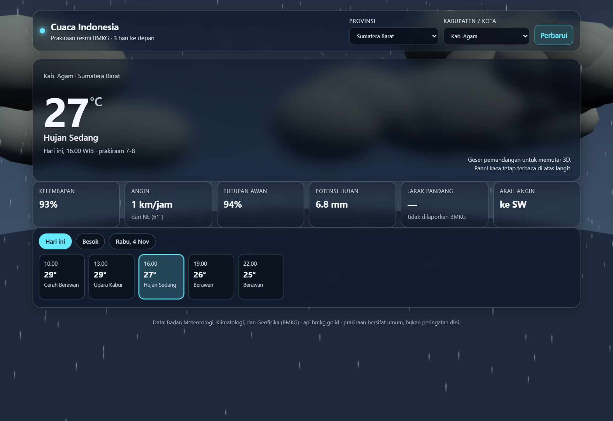
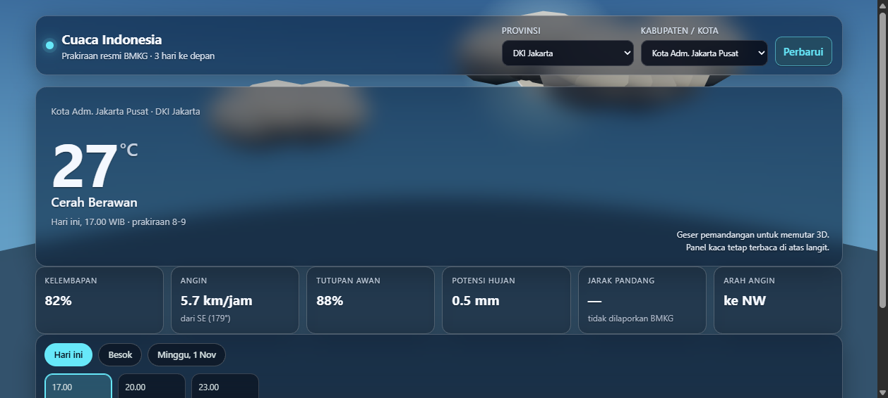
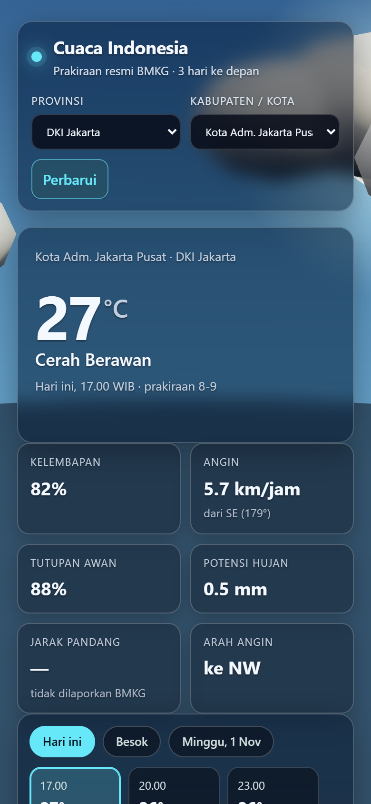

<div align="center">

# 🌤️ Cuaca Indonesia

**Prakiraan cuaca resmi BMKG untuk 514 kabupaten/kota — di atas diorama 3D yang berubah mengikuti cuaca.**

Matahari bersinar saat cerah, awan berarak, hujan turun — semua dirender langsung di browser.

[🚀 Buka Live Demo](https://zyraf13.github.io/cuaca-indonesia/)



<sub>Tanpa backend · Tanpa login · 134 kB gzip · Data real-time dari api.bmkg.go.id</sub>

</div>

## Tampilan Lainnya

| Cerah — Jakarta Pusat | Mobile (390 px) |
|---|---|
|  |  |

## Fitur

- 🗺️ **514 kabupaten/kota, 37 provinsi** — API BMKG melayani prakiraan per titik desa, jadi tiap
  kab/kota diwakili satu titik resmi (nama desa & kecamatan tampil di tooltip lokasi)
- 🌦️ **Diorama 3D reaktif** — langit, matahari, awan, hujan & petir berganti sesuai slot prakiraan
  yang dipilih; bisa diputar dengan drag (OrbitControls)
- 🕒 **Timeline 3 hari × slot 3 jam** — tab per hari, jam otomatis mengikuti timezone lokal lokasi
  (WIB/WITA/WIT)
- 📊 **6 metrik per slot** — kelembapan, angin, tutupan awan, potensi hujan, jarak pandang, arah angin
- 🪟 **Glassmorphism murni CSS** — panel blur di atas kanvas 3D full-viewport; fallback solid otomatis
  jika browser tak mendukung `backdrop-filter`
- 🛡️ **Tahan badai** — cache 30 menit, throttle 1,2 s, backoff `Retry-After` saat rate-limit 429;
  blur dimatikan sendiri kalau GPU tak sanggup target 20 FPS
- 🔗 **Deep-link** — URL menyimpan wilayah (`/#31.71`), tinggal dibagikan

## Jalankan

```bash
npm install
npm run dev      # http://localhost:5173
npm test         # parser, timezone, cache/throttle/backoff
npm run build    # dist/ siap deploy statis
npm run regions  # regenerasi public/regions.json
```

## Struktur

```
src/core.js      parser BMKG, timezone per lokasi, klasifikasi kondisi, client cache/throttle
src/scene3d.js   diorama Three.js prosedural (tanpa aset eksternal), fallback 2D
src/main.js      UI: picker wilayah, kartu metrik, timeline 3 hari, hash routing
scripts/         build-regions.mjs (wilayah.sql → public/regions.json)
test/core.test.js
```

## Catatan Data

- Satu-satunya sumber: `api.bmkg.go.id/publik/prakiraan-cuaca` — resmi, CORS `*` terverifikasi,
  frontend memanggil langsung tanpa proxy
- Jika BMKG tidak menyertakan metrik (mis. jarak pandang), tampil **`—` + "tidak dilaporkan BMKG"**,
  bukan angka karangan
- Prakiraan bersifat umum — bukan peringatan dini

## Roadmap

- [ ] v1.1 — peringatan cuaca ekstrem & nowcast
- [ ] v2.0 — peta globe multi-lokasi

---

<div align="center">

**[Live Demo](https://zyraf13.github.io/cuaca-indonesia/)** · dibangun dengan
[Three.js](https://threejs.org) + [Vite](https://vitejs.dev) · data oleh [BMKG](https://www.bmkg.go.id)

</div>

